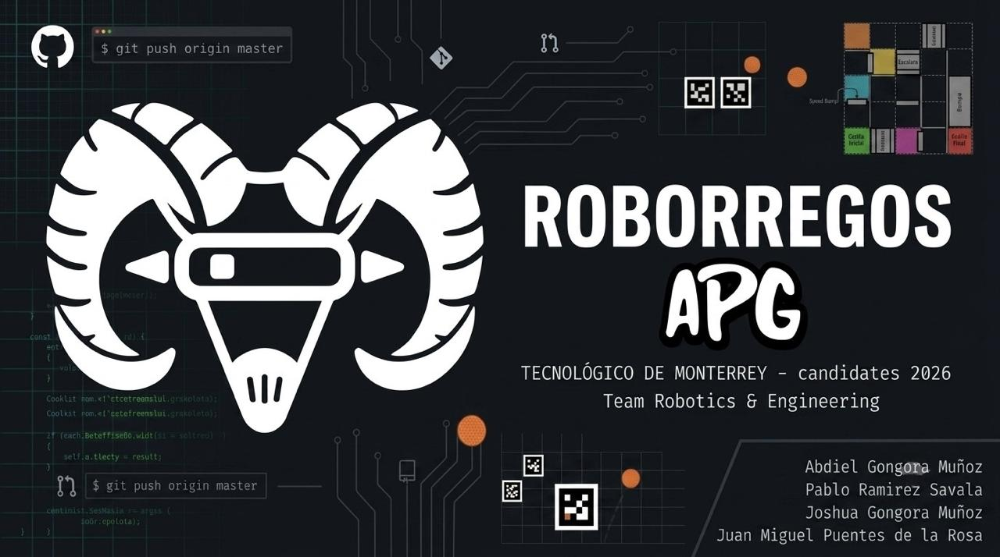

<div align="center">
  
</div>

<div align="center">
  <h1>APG Project</h1> 
  <p><b>RoBorregos Candidates 2026 | Tecnológico de Monterrey</b></p>
</div>

<br>

## 📌 About The Project

We are **APG**, a development and robotics team participating in the **Candidates 2026** competition organized by **RoBorregos** at Tecnológico de Monterrey. Our goal is to design, build, and program a fully autonomous robot capable of solving challenges in logic, navigation, image processing, and system control.

This repository contains the full documentation of our project:
* **Software:** Navigation algorithms, color detection, and computer vision.
* **Electronics:** Schematic designs, PCB development, and power management.
* **Mechanics:** 3D CAD models, assemblies, and structural analysis of the chassis and gripping systems.

<br>

## 🎯 The Challenge

The competition evaluates the performance of our autonomous robot across two main tracks:
* **Track A (MAZE):** Autonomous maze exploration and navigation using color sensors, obstacle traversal (ramps, stairs, and speed bumps), and ArUco marker detection via computer vision.
* **Track B (Levels):** Object manipulation (locating and transporting a ball), path-following with line avoidance, and real-time instruction execution based on colored floor tiles.

<br>

<div align="center">
  <h1>Team Members</h1> 
</div>

* Abdiel Gongora Muñoz
* Joshua Gongora Muñoz
* Pablo Ramirez Zavala
* Juan Miguel Puentes de la Rosa

<br>
<br>

## 🛠️ Our Progress


### 🚗 Movimiento básico y pruebas (ESP32)

Como primera prueba de control, implementamos el manejo de dirección y velocidad de un par de motores DC con encoders desde un ESP32. El sistema recibe comandos de texto por el Monitor Serie/Terminal para avanzar, retroceder, girar sobre su propio eje o detenerse, lo cual nos sirvió como validación inicial antes de integrar la lógica autónoma.

A diferencia de Arduino (que usa `analogWrite()`), el ESP32 genera las señales PWM mediante su periférico de hardware **LEDC (LED Control)**. Durante el desarrollo nos encontramos con que `ledcAttachChannel()` solo existe a partir de la v3.0 de `arduino-esp32`; como trabajamos con la v2.x (Legacy), tuvimos que usar en su lugar `ledcSetup()`, `ledcAttachPin()` y `ledcWrite(canal, duty)`.

```cpp
#include <Arduino.h> //Declaramos la libreria de arduino para que nos deje usar la variable tipo byte

#define ENCODER_A 4 //Aqui se definen los pines a los que estan conectados los encoders
#define ENCODER_B 5 //Aqui se definen los pines a los que estan conectados los encoders

//Definimos los pines de control shield
// Sirven para habilitar los motores y el sentido de giro de los motores
const int E1PIN = 10;
const int M1PIN = 12;
const int E2PIN = 11;
const int M2PIN = 13;

// Configuración de Hardware PWM para ESP32 (Periférico LEDC)
const int CANAL_PWM_IZQ = 0; // Canal LEDC 0
const int CANAL_PWM_DER = 1; // Canal LEDC 1
const int FREC_PWM = 5000; // Frecuencia en Hz, 5 kHz es la ideal para los motores y evitar movimientos bruscos
const int RES_PWM = 8; // Resolución de 8 bits (Valores de 0 a 255)

struct Motor{
  byte enPIN;
  byte directionPIN;
};

// Creamos la variable Motor con la estructura motor
// Creamos los dos objetos motores del tipo Motor porque son 2 motores con llaves {}
const Motor motorIzq = {E1PIN, M1PIN};
const Motor motorDer = {E2PIN, M2PIN};

const int HaciaAdelante = LOW;
const int HaciaAtras = HIGH;

//Definimos funciones para mover los motores a diferentes velocidades, direcciones y detenerlos
void moverMotores(int dirIzq, int velIzq, int dirDer, int velDer);
void detenerMotores();

void setup(){
  //Hacemos una comunicacion serial de 115200 baudios
  Serial.begin(115200);

  //Configuramos los encoders como entradas
  pinMode(ENCODER_A, INPUT);
  pinMode(ENCODER_B, INPUT);
  pinMode(motorIzq.directionPIN, OUTPUT);
  pinMode(motorDer.directionPIN, OUTPUT);

  //Configuramos los motores con la configuracion de canales PWM en ESP32
  // 1. Configuramos el canal (Canal, Frecuencia, Resolución)
  ledcSetup(CANAL_PWM_IZQ, FREC_PWM, RES_PWM);
  ledcSetup(CANAL_PWM_DER, FREC_PWM, RES_PWM);
  // 2. Asignamos el pin al canal correspondiente (Pin, Canal)
  ledcAttachPin(motorIzq.enPIN, CANAL_PWM_IZQ);
  ledcAttachPin(motorDer.enPIN, CANAL_PWM_DER);

  detenerMotores();
}

void loop(){
  Serial.print("¿Que movimiento quieres hacer?");
  Serial.println("Opciones: [a]vanzar, [r]etroceder, [d]erecha, [i]zquierda, [p]arar");
  Serial.print("Ingresa una opcion: ");

  while (Serial.available() == 0) {
    // Bloquea la ejecución hasta que llegue un dato
  }

  // 3. Leer el texto que ponga el usuario
  String direccion = Serial.readStringUntil('\n');
  direccion.trim(); // Elimina espacios en blanco y saltos de línea (\r, \n)
  Serial.println(direccion); // Muestra lo que el usuario escribió

  // 4. Evaluar la acción y controlar los motores
  if (direccion == "a" || direccion == "avanzar") {
    Serial.println("Moviendo hacia adelante");
    moverMotores(HaciaAdelante, 200, HaciaAdelante, 200);
  }
  else if (direccion == "r" || direccion == "retroceder") {
    Serial.println("Moviendo hacia atras");
    moverMotores(HaciaAtras, 200, HaciaAtras, 200);
  }
  else if (direccion == "i" || direccion == "izquierda") {
    Serial.println("Girando a la izquierda");
    // Giro sobre su eje: Motor izquierdo atrás, derecho adelante
    moverMotores(HaciaAtras, 200, HaciaAdelante, 200);
  }
  else if (direccion == "d" || direccion == "derecha") {
    Serial.println("Girando a la derecha");
    // Giro sobre su eje: Motor izquierdo adelante, derecho atrás
    moverMotores(HaciaAdelante, 200, HaciaAtras, 200);
  }
  else if (direccion == "p" || direccion == "parar") {
    Serial.println("Motores detenidos");
    detenerMotores();
  }
  else {
    Serial.println("Opción no disponible. Intenta de nuevo.");
  }

  delay(1000); // Pausa antes de volver a preguntar al usuario
}

// Funcion para dar el sentido y velocidad (PWM) de ambos motores
void moverMotores(int dirIzq, int velIzq, int dirDer, int velDer) {
  // Dirección del motor (HIGH / LOW)
  digitalWrite(motorIzq.directionPIN, dirIzq);
  digitalWrite(motorDer.directionPIN, dirDer);
  // Velocidad PWM a través del periférico LEDC de ESP32
  ledcWrite(CANAL_PWM_IZQ, velIzq);
  ledcWrite(CANAL_PWM_DER, velDer);
}

//Definimos en la funcion detenerMotores que la velocidad de ambos motores es 0 para que se detengan
void detenerMotores() {
  ledcWrite(CANAL_PWM_IZQ, 0);
  ledcWrite(CANAL_PWM_DER, 0);
}
```

📄 **Documentación completa:** [Ver documento detallado](https://docs.google.com/document/d/1L9G4jsoBlEPP43StgHrCMGgcGLqekIltsTy_N-n6iCA/edit?usp=sharing)

**Referencias técnicas consultadas:**
* [Guía de migración de Arduino ESP32 (Espressif)](https://docs.espressif.com/projects/arduino-esp32/en/latest/migration_guides/2.x_to_3.0.html) — tabla comparativa de funciones Legacy (2.0) vs 3.0.
* [Random Nerd Tutorials - ESP32 PWM con Arduino IDE](https://randomnerdtutorials.com/esp32-pwm-arduino-ide/) — conceptos de canales, frecuencia y resolución.
* [DFRobot Wiki (DRI0017 - Motor Shield Reference)](https://wiki.dfrobot.com/dri0017/docs/18141) — asignación de pines de habilitación.
* Tutorial de Motores DC y Control Lógico: https://www.youtube.com/watch?v=DYMvm6qV1uQ
* Configuración del Entorno Serie y Estructuras: https://www.youtube.com/watch?v=ADPpHxj5Nbg
* Consulta técnica a Gemini (IA de Google) para entender la diferencia de versiones en las funciones PWM del ESP32 y corregir errores de compilación.

<br>

### 🦾 Garra: demo de sujeción de la pelota

Este código es una primera demo de la garra para la sección de manipulación de objetos (Track B). Usa dos servomotores y una función `leerDistanciaPelota()` (aún por definir con el sensor real) que determina si la pelota está lo suficientemente cerca para cerrar la garra.

```cpp
#include <Servo.h>

Servo Servol;
Servo Servoi;

int MotorIA = 4; //Pin del motor izquierdo adelante
int MotorIR = 5; //Pin del motor izquierdo reversa
int MotorDA = 6; //Pin del motor derecho adelante
int MotorDR = 7; //Pin del motor derecho adelante

float distanciaPelota = -1; // Inicializamos distancia

//Funcion para definir la distancia de la pelota por definir
float leerDistanciaPelota() {
  return -1;
}

void setup(){

  Serial.begin(9600);

  pinMode(MotorIA, OUTPUT);
  pinMode(MotorIR, OUTPUT);
  pinMode(MotorDA, OUTPUT);
  pinMode(MotorDR, OUTPUT);

  Servol.attach(11);
  Servoi.attach(10);
  Servol.write(0);
  Servoi.write(0);

  stop(); // motores apagados al iniciar
}

void loop() {

  // Funcion donde si la distancia de la pelota esta a la necesaria, se cierra la garra o se acciona el servo
  distanciaPelota = leerDistanciaPelota();

  if (distanciaPelota <= 20) {
    Servol.write(90);   // cerrar garra
  } else {
    Servol.write(0);    // abrir garra
  }

}

//funcion de Paro de motores.
void stop(){
    digitalWrite(MotorIA,LOW);
    digitalWrite(MotorDA,LOW);
    digitalWrite(MotorIR,LOW);
    digitalWrite(MotorDR,LOW);
}
```

> ⚠️ Nota: `leerDistanciaPelota()` todavía es un placeholder (`return -1`); falta integrar el sensor de distancia real para que la garra cierre automáticamente al detectar la pelota.

**Referencia:** Para este código nos inspiramos también en un proyecto propio con servomotores hecho previamente en la preparatoria (PrepaTec) por Abdiel Gongora.

<br>

### 🤖 Código final del robot: Pista A, Pista B y ESP32-CAM

El robot usa dos placas: una **ESP32 WROOM-32 DevKit de 38 pines** que controla motores, sensores y garra, y una **ESP32-CAM (OV2640)** que procesa la imagen y le manda los resultados por UART. Hay un programa por pista para la ESP32 y uno para la cámara.

| Archivo | Placa | Qué hace |
|---|---|---|
| `main_pistaa.cpp` | ESP32 DevKit | Laberinto 5x5: explora con BFS, va a la meta, regresa por el mismo camino (bonus 1), muestra los colores y el ArUco (bonus 2) |
| `main_pistab.cpp` | ESP32 DevKit | Sección 1: agarrar la pelota · Sección 2: cruzar sin pisar líneas blancas · Sección 3: seguir los colores del piso |
| `cam.cpp` | ESP32-CAM | Detecta la pelota naranja y calcula su distancia; lee marcadores ArUco 4x4_50 |
| `camera_pins.h` | ESP32-CAM | Pines de la cámara del modelo AI-Thinker |
| `aruco_dict_4x4_50.h` | ESP32-CAM | Tabla de los 50 marcadores ArUco |
| `Generar_tabla_aruco.py` | Computadora | Genera la tabla de ArUco con OpenCV |

#### 🔌 Componentes y pines

| Componente | Conexión a la ESP32 |
|---|---|
| Driver TB6612FNG | Motor derecho PWMA 25, AIN1 26, AIN2 27 · Motor izquierdo PWMB 13, BIN1 32, BIN2 33 · STBY 14 |
| 2 motores JGA25-371 200 RPM con encoder | Encoder derecho A 34 / B 35 · Encoder izquierdo A 36 / B 39 |
| 3 ultrasónicos HC-SR04 | TRIG compartido 5 · ECHO frente 19, izquierda 18, derecha 23 (cada ECHO con divisor 1 kΩ / 2 kΩ) |
| MPU6050, TCS34725 y OLED SSD1306 | I2C: SDA 21, SCL 22 (0x68, 0x29 y 0x3C) |
| Servo de la garra | 4 |
| ESP32-CAM | IO14 de la cam → GPIO16 (RX2) · GPIO17 (TX2) → IO13 de la cam · GND común |
| LiPo 11.1 V 3S 2100 mAh + LM2596 | La batería alimenta el TB6612; el LM2596 baja a 5 V para la ESP32, la cámara, el servo y los ultrasónicos |

La cámara manda por UART un número por línea con la distancia de la pelota en mm (`-1` si no la ve) y `A<id>` cuando reconoce un ArUco.

#### 🧠 Síntesis de cada código

**Pista A – `main_pistaa.cpp`**
* **Movimiento:** los encoders cuentan pulsos con interrupciones y el robot avanza por celdas de 30 cm (`PULSOS_CELDA`), con corrección proporcional para ir derecho (`manejarRecto`).
* **Giros:** de 90° integrando el giroscopio del MPU6050 (`girar`, `faceDirection`).
* **Paredes:** los 3 ultrasónicos marcan las paredes de cada celda en `wallMap`.
* **Navegación:** en cada celda se recalcula un **BFS**. Primero va a la celda sin visitar más cercana para explorar y luego toma el camino más corto a la meta. Al llegar se regresa por la ruta guardada (bonus 1).
* **Obstáculos:** con el acelerómetro detecta rampas y escaleras para dar más fuerza al subir e ir lento al bajar; si se atora en un speedbump, empuja.
* **Colores y ArUco:** el TCS34725 compara el color del piso con una tabla de referencias y la OLED muestra el color de cada celda y el ID del ArUco que manda la cámara.

**Pista B – `main_pistab.cpp`**
* **Sección 1:** con BFS rodea la caja del centro, entra por el lado abierto y la garra se cierra sola cuando la cámara ve la pelota a menos de `CERRAR_MM`. Si se le cae, la busca (`recuperarPelota`).
* **Sección 2:** avanza en una fila leyendo el sensor de color en modo rápido; si ve una línea blanca se hace atrás y se cambia a la otra fila.
* **Sección 3:** lee el color de cada casilla y gira según el reglamento (azul derecha, amarillo izquierda, naranja arriba, rosa abajo) hasta el verde.
* **Checkpoints:** la etapa se guarda con `Preferences`; si el robot arranca sobre rojo, sigue en la sección guardada.

**ESP32-CAM – `cam.cpp`**
* Toma fotos de 160x120 en RGB565 y separa cada pixel en rojo, verde y azul.
* **Pelota:** busca el recuadro naranja y calcula la distancia con semejanza de triángulos (`D = W × F / P`).
* **ArUco:** busca la región oscura, lee los 4x4 bits y los compara con la tabla en las 4 rotaciones.
* `Generar_tabla_aruco.py` crea `aruco_dict_4x4_50.h` con el diccionario oficial de OpenCV.

📄 **Documentación completa:** `Documentacion_Codigos_Robot.docx` (código completo, explicación de cada función, datasheets y fuentes).

**Referencias técnicas consultadas:**
* [Repositorio bluetooth-maze-solving-robot-car (rahulraghavendrar)](https://github.com/rahulraghavendrar/bluetooth-maze-solving-robot-car): base de `solveMazeBFS`, `bfsSeccion1`, `faceDirection`, `drivePath` y `sensarParedes`.
* [Curio Res – ArduinoTutorials](https://github.com/curiores/ArduinoTutorials) y [su video](https://youtu.be/dTGITLnYAY0): `readEncoder` y `setMotor`.
* [SparkFun – Two-Wheeled Robot Precision Driving with Encoder Feedback](https://news.sparkfun.com/3276): corrección proporcional en `manejarRecto`.
* [SparkFun – TB6612FNG Hookup Guide](https://learn.sparkfun.com/tutorials/tb6612fng-hookup-guide/all): tabla de verdad del driver.
* [Random Nerd Tutorials – ESP32 con HC-SR04](https://randomnerdtutorials.com/esp32-hc-sr04-ultrasonic-arduino/) y [foro de Arduino – TRIG compartido](https://forum.arduino.cc/t/multiple-hc-sr04-with-as-few-pins-as-possible/475135): `leerDistanciaCM`.
* [How To Mechatronics – Arduino y MPU6050](https://howtomechatronics.com/tutorials/arduino/arduino-and-mpu6050-accelerometer-and-gyroscope-tutorial/): `girar`, `calibrarGiroscopio` y `leerInclinacion`.
* [Adafruit_TCS34725](https://github.com/adafruit/Adafruit_TCS34725) y [Adafruit_SSD1306](https://github.com/adafruit/Adafruit_SSD1306): `leerColor`, `hayLineaBlanca` y `mostrarTexto`.
* [ESP32Servo](https://github.com/madhephaestus/ESP32Servo): servo de la garra.
* Random Nerd Tutorials: [I2C Scanner](https://randomnerdtutorials.com/esp32-i2c-scanner-arduino/), [UART](https://randomnerdtutorials.com/esp32-uart-communication-serial-arduino) y [Preferences](https://randomnerdtutorials.com/esp32-save-data-permanently-preferences/).
* [Espressif – CameraWebServer](https://github.com/espressif/arduino-esp32/tree/master/libraries/ESP32/examples/Camera/CameraWebServer) y [esp32-camera](https://github.com/espressif/esp32-camera): configuración de la cámara y `camera_pins.h`.
* [Microsoft Learn – Working with 16-bit RGB](https://learn.microsoft.com/en-us/windows/win32/directshow/working-with-16-bit-rgb): formato RGB565.
* [PyImageSearch – Distancia de la cámara a un objeto](https://pyimagesearch.com/2015/01/19/find-distance-camera-objectmarker-using-python-opencv/): `calcularDistanciaMM`.
* [OpenCV – Detection of ArUco Markers](https://docs.opencv.org/4.x/d5/dae/tutorial_aruco_detection.html): estructura del marcador y diccionario 4x4_50.
* [Espressif – Migración de 2.x a 3.0](https://docs.espressif.com/projects/arduino-esp32/en/latest/migration_guides/2.x_to_3.0.html): cambio de `analogWriteFrequency` en el core 3.

**Datasheets:**
* [ESP32 Series](https://documentation.espressif.com/esp32_datasheet_en.pdf) · [ESP32-WROOM-32](https://documentation.espressif.com/esp32-wroom-32_datasheet_en.pdf) · [ESP32-CAM](https://github.com/raphaelbs/esp32-cam-ai-thinker/blob/master/assets/ESP32-CAM_Product_Specification.pdf) · [OV2640](https://files.waveshare.com/wiki/common/OV2640DS_en.pdf)
* [TB6612FNG](https://cdn.sparkfun.com/datasheets/Robotics/TB6612FNG.pdf) · [JGA25-371 (hoja del vendedor)](https://docs.cirkitdesigner.com/component/a274523d-ec09-4b64-8cac-8c40a853f967/jga25-371dc-motor-with-encoder) · [LM2596](https://www.ti.com/lit/ds/symlink/lm2596.pdf)
* [HC-SR04](https://cdn.sparkfun.com/datasheets/Sensors/Proximity/HCSR04.pdf) · [TCS34725](https://cdn-shop.adafruit.com/datasheets/TCS34725.pdf) · [MPU6050](https://alliance.seas.upenn.edu/~medesign/wiki/uploads/Guides/MPU6050_datasheet.pdf) · [SSD1306](https://cdn-shop.adafruit.com/datasheets/SSD1306.pdf) · [SG90](https://bit.nkust.edu.tw/~csshieh/teach/111A/mc/datasheet/SG90.pdf)

**Uso de IA:** consulta técnica a Claude (IA de Anthropic). Las ideas de implementación fueron del equipo. La IA nos ayudó en:
* Corregir errores cuando el código no compilaba o no funcionaba.
* Juntar funciones de distintas fuentes.
* Implementar las funciones que no tienen fuente externa.
* Hacer las fórmulas de medición del avance (`PULSOS_CELDA`, `cmAPulsos` y `avance`).
* Entender el código de las fuentes.

<br>